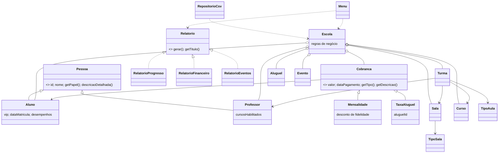

# Escola de Música "Nota Máxima"

Sistema em Java (console) para gerenciar uma escola de música: cadastros, turmas e horários,
aluguel de salas e estúdios, desempenho dos alunos, recitais, pagamentos e plano de fidelidade.
Trabalho da P2 de Programação Orientada a Objetos.

## O que o sistema faz

| Área | Regras implementadas |
|---|---|
| Cursos e aulas | Cursos Piano, Violão e Canto. Aula individual R$ 280,00/mês (1 aluno) e em grupo R$ 160,00/mês (até 6). Professor, sala e aluno não podem ter dois compromissos no mesmo horário. |
| Aluguel | Sala de prática R$ 30,00/h e estúdio R$ 90,00/h (só VIP). VIP tem 20% de desconto. Sala não pode ser alugada em horário ocupado. |
| Desempenho | Notas de 0 a 10 por aluno e por curso, com relatório de progresso (média, última nota, histórico). |
| Recitais | Agendamento com número de vagas. Metade das vagas fica reservada ao VIP até 7 dias antes do evento; depois, ficam livres para todos. |
| Pagamentos | Mensalidades e taxas de aluguel viram cobranças pendentes que são quitadas depois. |
| Fidelidade | 5% de desconto na mensalidade por ano completo de matrícula, até 15%. |
| Cadastro, edição e remoção | Alunos, professores, cursos, salas, turmas, eventos, aluguéis e inscrições. A remoção respeita as regras (ex.: não remove aluno com cobrança pendente). |
| Persistência | Tudo é salvo em arquivos CSV na pasta `dados/` e recarregado ao abrir. |
| Relatórios | Progresso do aluno, financeiro e recitais. Podem ser vistos na tela ou salvos em `relatorios/*.txt`. |

## Como executar

**Requisitos:** JDK 17 ou mais novo (testado com JDK 21). Nenhuma biblioteca externa.
Para conferir: `java -version` e `javac -version`.

### Jeito mais simples (scripts)

- Windows: dê dois cliques em `rodar.bat` (ou rode `rodar.bat` no terminal).
- Linux/macOS: `./rodar.sh`

### Pelo terminal, passo a passo

Dentro da pasta `NotaMaxima` (a que contém a pasta `escola`):

```
javac -encoding UTF-8 -d out escola/*.java
java -Dfile.encoding=UTF-8 -cp out escola.Main
```

No Windows, se os acentos saírem errados, rode antes `chcp 65001`.

### Pelo VS Code

Instale o *Extension Pack for Java*, abra a pasta `NotaMaxima`, abra `escola/Main.java` e use **Run** (Ctrl+F5).

### Onde ficam os dados

Por padrão, em `dados/` (e `relatorios/`) na pasta de onde você roda o programa. Para usar outra pasta:
`java -cp out escola.Main minha-pasta`. Para recomeçar do zero, use o menu **12 > Zerar todos os dados**
ou apague a pasta `dados/`.

## Roteiro rápido de demonstração

1. **8** (carregar dados de exemplo) e depois **7** (listar tudo).
2. **3 > 1**: gere a mensalidade da Maria (VIP, 2 anos de casa) e veja o desconto de 10%: R$ 252,00.
3. **4 > 1**: alugue o estúdio para a Maria (R$ 144,00 por 2h) e depois para o João, que é bloqueado por não ser VIP.
4. **5 > 1**: registre uma nota 9,5 e depois uma nota 11 (bloqueada). Veja o relatório em **5 > 2**.
5. **6**: crie um recital com 4 vagas e inscreva João, Carlos e Dora (não VIP): o terceiro é bloqueado pela reserva VIP.
   Use **9** para mudar a data de hoje para menos de 7 dias antes do evento e inscreva de novo: agora passa.
6. **10**: edite um aluno e tente remover a Maria (bloqueado: tem cobrança pendente).
7. **11 > 2**: relatório financeiro, salvando em arquivo.
8. Feche e abra o programa de novo: os dados continuam lá.

Existe também uma demonstração automática, sem menu: `java -cp out escola.Demonstracao`.

## Testes automáticos

Há 41 testes das regras de negócio, da persistência e dos tratamentos de erro, sem biblioteca externa:

```
./testes.sh          (Linux/macOS)
testes.bat           (Windows)
```

O resultado esperado termina com `Resultado: 41 passaram, 0 falharam.`

## Estrutura do projeto

```
NotaMaxima/
├── escola/                  código-fonte (pacote escola)
│   ├── Main.java            ponto de entrada
│   ├── Menu.java            interface de console (só lê e mostra; não tem regra de negócio)
│   ├── Escola.java          fachada: aplica TODAS as regras de negócio
│   ├── Pessoa.java          (abstrata) base de Aluno e Professor
│   ├── Aluno.java / Professor.java
│   ├── Cobranca.java        (abstrata) base de Mensalidade e TaxaAluguel
│   ├── Mensalidade.java / TaxaAluguel.java
│   ├── Relatorio.java       (interface) RelatorioProgresso / RelatorioFinanceiro / RelatorioEventos
│   ├── Curso, Sala, TipoSala, Turma, TipoAula, Horario, Aluguel, Evento, Desempenho, PlanoFidelidade, Dinheiro
│   ├── RepositorioCsv.java  salva e carrega os arquivos CSV
│   └── RegraDeNegocioException, PersistenciaException
├── test/escola/TestesEscola.java
├── rodar.sh / rodar.bat / testes.sh / testes.bat
└── README.md
```

## Decisões de design (POO)

**Encapsulamento.** Todos os atributos são `private`. As listas só saem como `unmodifiableList`.
Os métodos que alteram estado (`Turma.adicionarAluno`, `Evento.inscrever`, `Aluno.definirVip`...) têm acesso
restrito ao pacote, então só a `Escola` os chama, e só depois de conferir as regras. Ninguém de fora consegue,
por exemplo, colocar um segundo aluno numa turma individual.

**Abstração e herança.**
- `Pessoa` (abstrata) concentra id e nome (com validação). `Aluno` e `Professor` herdam dela e só acrescentam o que é seu.
- `Cobranca` (abstrata) concentra valor, aluno e o ciclo "pendente → pago". `Mensalidade` e `TaxaAluguel` herdam
  dela e definem tipo e descrição. Uma terceira cobrança (multa, taxa de matrícula) entra criando só uma subclasse.

**Polimorfismo.**
- `Escola.getPessoas()` devolve `List<Pessoa>`, e o menu chama `getPapel()` e `descricaoDetalhada()` sem saber se é aluno ou professor.
- A lista de cobranças mistura mensalidades e taxas de aluguel; pagamento, relatório financeiro e arquivo tratam todas igual.
- `Relatorio` é uma interface: o menu e o `ExportadorRelatorio` trabalham com ela, então um relatório novo não exige mudar nenhum dos dois.

**Enums com comportamento.** `TipoAula` e `TipoSala` guardam preço, limite de alunos e se é alugável ou exclusivo VIP.
Mudar um valor exige mexer em um único lugar.

**Separação de responsabilidades.** `Menu` (interface), `Escola` (regras), `RepositorioCsv` (arquivos) e as classes de
domínio não dependem umas das outras de forma circular. Trocar o console por outra interface não mexe nas regras.

### Diagrama de classes



## Persistência e tratamento de erros

Os dados ficam em CSV (separador `;`, UTF-8), um arquivo por tipo: `alunos.csv`, `professores.csv`, `habilitacoes.csv`,
`salas.csv`, `turmas.csv`, `matriculas.csv`, `alugueis.csv`, `eventos.csv`, `inscricoes.csv`, `cobrancas.csv`,
`desempenhos.csv`, `cursos.csv` e `meta.csv` (próximo id). O programa salva depois de cada ação do menu.

O sistema não quebra em situações comuns:
- **Regra violada** (ex.: aluguel em horário ocupado): mostra `>> BLOQUEADO: ...` e volta ao menu.
- **Digitação inválida** (letra no lugar de número, data errada): pede de novo ou mostra "Entrada inválida".
- **Pasta ou arquivo de dados ausente**: começa vazio ou ignora só o arquivo faltante, com um `[aviso]`.
- **Linha corrompida num CSV**: só aquela linha é ignorada (com aviso do arquivo e da linha); o resto carrega.
- **Falha ao gravar** (sem permissão, disco cheio): mostra aviso e o programa continua rodando.
- **Entrada do teclado encerrada** (Ctrl+D): salva e sai normalmente.
- Os arquivos são gravados em um temporário e trocados no fim, para não ficarem pela metade.

## Escolhas que o enunciado não define

- Salas de prática e estúdio só servem para aluguel; as aulas acontecem em salas do tipo "aula".
- Com número ímpar de vagas, a reserva VIP arredonda para baixo (5 vagas reservam 2).
- A fidelidade conta a partir da data de matrícula do aluno na escola, e não da turma.
- Remover um aluno apaga também matrículas, inscrições e histórico de cobranças dele, mas só se ele não tiver nada pendente.
- Só é possível ter uma mensalidade pendente por aluno e turma ao mesmo tempo.

## Limitações e melhorias futuras

- Relatórios saem em texto; um próximo passo é gerar PDF (biblioteca iText) e salvar os dados no Google Drive.
- A `Escola` concentra muitas regras; com mais tempo, daria para dividi-la em serviços (turmas, financeiro, eventos).
- Interface gráfica (Swing/JavaFX) ou web no lugar do console.
- Migrar os testes para JUnit (aqui foram feitos sem biblioteca para o projeto rodar apenas com o JDK).
